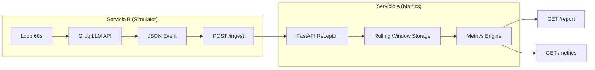
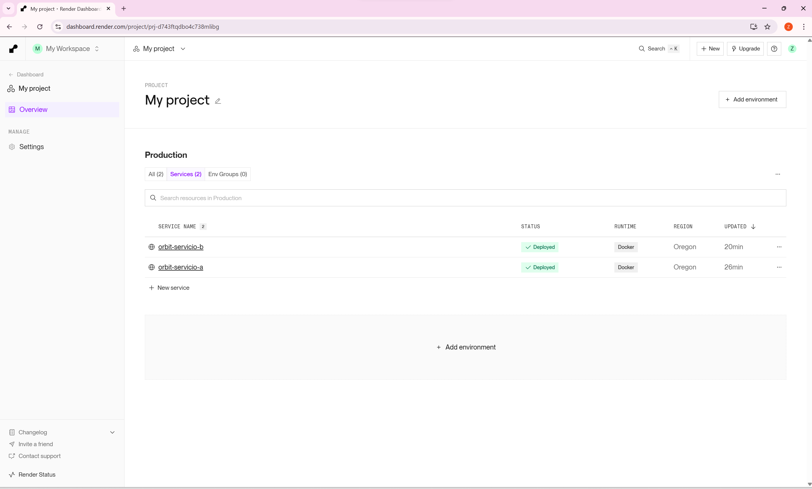
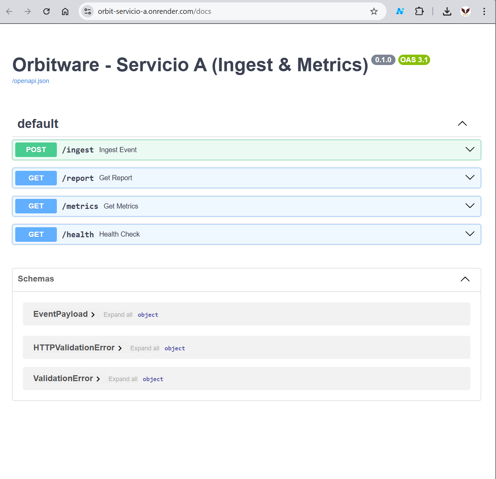
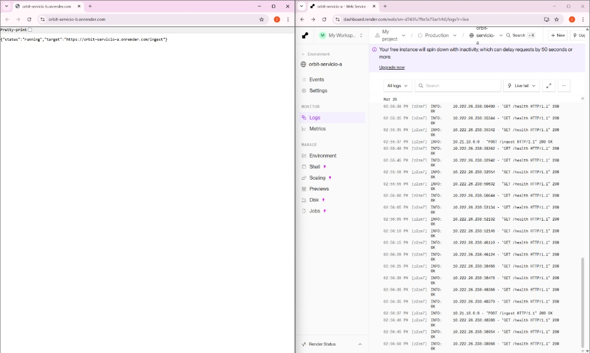
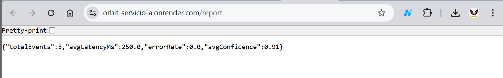
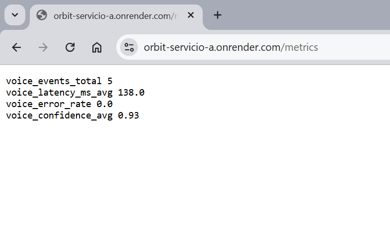
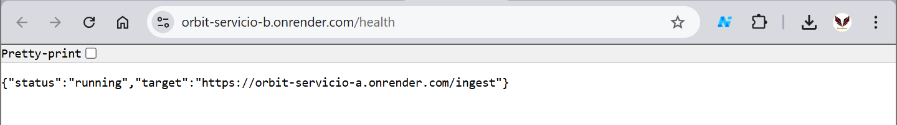

# Orbitware Engineering Challenge

Sistema de ingesta y monitoreo de métricas para un agente de IA, compuesto por microservicios contenerizados y desplegados en Render.

## 🚀 URLs Públicas
* **Servicio A (Metrics API):** [https://orbit-servicio-a.onrender.com/docs](https://orbit-servicio-a.onrender.com/docs)
* **Reporte en vivo (JSON):** [https://orbit-servicio-a.onrender.com/report](https://orbit-servicio-a.onrender.com/report)
* **Servicio B (LLM Simulator):** [https://orbit-servicio-b.onrender.com/health](https://orbit-servicio-b.onrender.com/health)

## 🛠️ Arquitectura y Tecnologías
* **Servicio A (FastAPI):** Ingesta distribuida con validación estricta (Pydantic). Implementa una ventana móvil (5 min / 30 eventos) para el cálculo de KPIs en tiempo real.
* **Servicio B (Python/LLM):** Simulador que utiliza **Groq (Llama-3.3)** para generar intents y datos de latencia realistas cada minuto.
* **Infraestructura:** Contenerización con **Docker** y orquestación con **Docker Compose**.

## 📦 Ejecución Local
Para replicar el entorno completo:
1. Clonar el repositorio.
2. Crear un archivo `.env` con la variable `LLM_API_KEY`.
3. Ejecutar: `docker-compose up --build`

## 📈 Endpoints Clave
* `POST /ingest`: Punto de entrada de eventos.
* `GET /report`: Análisis estadístico de la ventana móvil.
* `GET /metrics`: Formato Prometheus para monitoreo externo.

## ✅ Validación de Entrega

Esta sección certifica el cumplimiento de los requisitos técnicos solicitados en el desafío.

### 🕒 Tiempo Invertido
* **Total estimado:** ~1.5 horas (Desarrollo, Dockerización y Despliegue).

### 📊 Diagrama de Flujo (Arquitectura)
Este diagrama describe cómo viajan los datos desde la generación en el LLM hasta la exposición de métricas:

---
## ✅ Proof of Work (Evidencia de Funcionamiento)

Esta sección certifica visualmente el cumplimiento de los requisitos técnicos en el entorno de producción (Render).

### 1. Despliegue de Infraestructura
Ambos microservicios (Servicio A y Servicio B) se encuentran en estado **Live** y gestionados mediante contenedores Docker en Render.

### 2. Documentación e Interfaz (Swagger)
El Servicio A expone una interfaz interactiva Swagger/OpenAPI para la validación de los esquemas de datos y endpoints.

### 3. Integración y Logs en Vivo
Evidencia de la comunicación exitosa entre el Simulador y la API. Se observa una ingesta constante de eventos cada 60 segundos con respuesta exitosa HTTP 200 OK.

### 4. Cálculo de Métricas en Tiempo Real (/report)
Validación del motor de agregados procesando datos dinámicos (latencia, tasa de error y confianza) sobre la ventana móvil.

### 5. Formato de Métricas Prometheus (/metrics)
Cumplimiento estricto del formato de texto plano solicitado para la integración con sistemas de monitoreo externos.

### 6. Estado de Salud y Configuración (Servicio B)
El simulador confirma su correcta operatividad y la URL de destino configurada mediante variables de entorno.

---
---
## 🎥 Presentación de Video (Loom)

### En el siguiente enlace se encuentra la explicación de la arquitectura, el código y la demostración en vivo:

https://www.loom.com/share/dfa68df86d9b4b8991a9b19009dc8b51

---